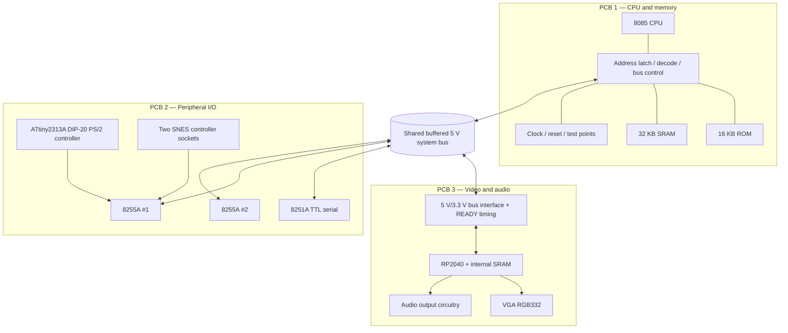
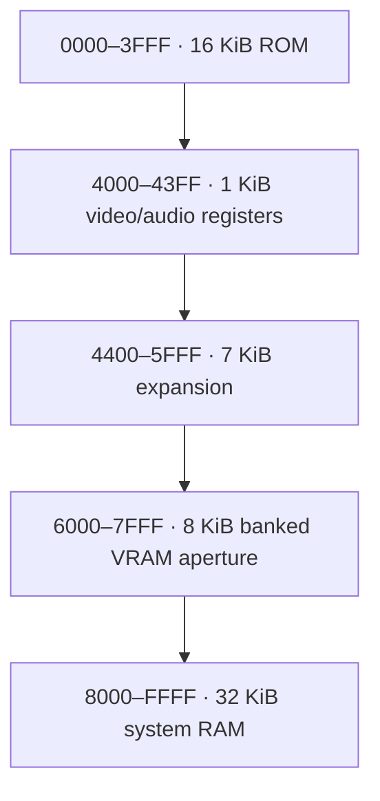

# Modular Intel 8085 Computer

A three-board, expandable 8-bit computer built around the Intel 8085, with TTL serial, PS/2 keyboard, two SNES controllers, and RP2040 VGA graphics and audio.

> **Status:** Architecture and address allocations agreed; electrical design and register details are preliminary. This is a design reference, not a manufacturing-ready schematic.

## System architecture

## Fixed 8085 memory map

All addresses hexadecimal. The 8085 has a 16-bit memory address bus and an independent 8-bit I/O address space.

| Address | Size | Assignment | Board |
|---|---:|---|---|
| `0000–3FFF` | 16 KiB | Boot ROM | 1 |
| `4000–40FF` | 256 B | Video control register region | 3 |
| `4100–41FF` | 256 B | Sprite / tilemap register region | 3 |
| `4200–42FF` | 256 B | Drawing engine register region | 3 |
| `4300–43FF` | 256 B | Audio register region | 3 |
| `4400–5FFF` | 7 KiB | Reserved expansion | — |
| `6000–7FFF` | 8 KiB | Bank-switched RP2040 video memory window | 3 |
| `8000–FFFF` | 32 KiB | System SRAM | 1 |

The 8 KiB VRAM window is **not** the full video memory size. The RP2040 has 264 KiB internal SRAM in total; a preliminary target is **192 KiB shared video allocation**, equivalent to 24 × 8 KiB banks. Actual available capacity depends on firmware, framebuffers, tilemaps, sprites, and audio buffers.

### Proposed RAM conventions

| Address | Use |
|---|---|
| `8000–80FF` | 256 B software variable area (not a hardware zero page) |
| `8100–81FF` | System variables |
| `8200–EFFF` | General programs, buffers and BASIC workspace |
| `F000–FFFF` | Stack and system workspace (stack starts near top and grows downward) |

## Fixed I/O allocations

| Port | Device / function |
|---|---|
| `00` | 8251A data: receive/read, transmit/write |
| `01` | 8251A status/read, mode-command/write |
| `02–0F` | Reserved |
| `10` | 8255A #1 Port A |
| `11` | 8255A #1 Port B |
| `12` | 8255A #1 Port C |
| `13` | 8255A #1 control |
| `14` | 8255A #2 Port A |
| `15` | 8255A #2 Port B |
| `16` | 8255A #2 Port C |
| `17` | 8255A #2 control |
| `18–FF` | Reserved / expansion |

**All video and audio registers are memory-mapped, not I/O-mapped.** The 8251A and two 8255As are I/O-mapped.

## Board documentation

- [PCB 1 — CPU, ROM, RAM, reset and bus](docs/01-cpu-board.md)
- [PCB 2 — Serial, 8255s, keyboard and SNES](docs/02-io-board.md)
- [PCB 3 — RP2040 VGA, audio and VRAM](docs/03-video-audio.md)
- [Expansion bus and interrupt plan](docs/04-bus-interrupts.md)
- [Build and verification plan](docs/05-build-plan.md)

## Design rules

1. PCB 1 must boot and execute ROM with other boards disconnected.
2. Only one device may drive the shared data bus at a time.
3. The 8085 multiplexed `AD0–AD7` lines require an ALE-controlled address latch.
4. RP2040 GPIO is **not 5 V tolerant**; level shifting and bus isolation are mandatory.
5. READY/wait-state generation must meet 8085 timing specifications in hardware.
6. Unused control and interrupt inputs must be held at defined levels.
7. Each board needs local decoupling, a ground plane, and test points.
8. Pinouts and chip-select equations must be verified against the exact IC datasheets before PCB fabrication.
